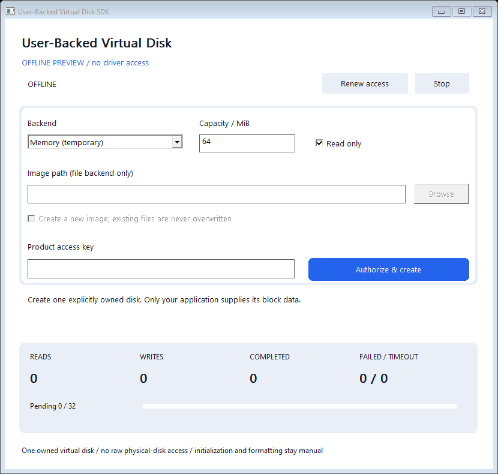

# User-Backed Virtual Disk SDK - Microsoft-signed Windows Kernel Block Device Driver

**Serve a real Windows virtual disk from your own C++ storage backend.**

The private Storport virtual miniport presents one explicitly owned disk. Your
application receives bounded block requests and supplies their results. The same
API can underpin image tools, controlled storage fixtures and custom storage
adapters; the included providers use RAM or a regular local image file.



**Microsoft-signed evaluation, Windows x64.** The complete 0.1.1 ZIP contains the native application, CLI, C++ example, SDK, installer sources and self-contained UI/console installers with the signed 0.1.0.0 driver. Actual installation, storage operations and removal passed Windows 10 x64 campaigns normally and under targeted Driver Verifier, with test-signing disabled. See [validation and boundaries](docs/VALIDATION.md).

## Scope

| Capability | Initial boundary |
| --- | --- |
| Virtual disk | One non-boot disk with fixed-medium semantics; 64 MiB..1 GiB, 512-byte sectors. |
| Application backend | Read, write and flush callbacks through one SDK session. |
| Bounded work | At most 32 queued requests and 64 KiB per transfer; one backend operation is processed at a time. |
| Memory provider | Temporary zero-initialized storage; closing it discards its contents. |
| Image provider | An existing regular local file of the exact capacity, or explicit creation with no overwrite. |
| Read only | Reject writes to the virtual disk; no physical disk is opened by the SDK. |

This is block-device integration, not a new filesystem implementation. The
operating system's filesystem drivers process any supported on-disk format.
The virtual device appears and disappears with its provider; this is separate
from swapping removable media inside a persistent disk device.
There is no automatic initialization, formatting, partition change, drive-letter
assignment, physical-disk access, boot/pagefile support, cloud client, encryption,
compression, snapshot engine or guaranteed crash-consistent persistence.

Remote, encrypted or compressed storage is a **possible application backend**,
not a bundled feature. Such backends need their own implementation, tests and
durability semantics. Backend operations are serialized in request order, so a
flush does not overtake an earlier write. RAM flushes acknowledge volatile
storage; the image provider uses write-through file access and `FlushFileBuffers`.
Neither is a backup or power-loss guarantee. Unsupported SCSI options, including
FUA/DPO and VERIFY commands, are refused rather than silently ignored.

## Run

1. Download the [complete signed ZIP](https://github.com/titanfyre/User-Backed-Virtual-Disk-SDK/releases/tag/v0.1.1), extract it and launch `UserBackedDisk.exe --preview` for an offline tour. The labelled preview never opens a driver or backend.
2. Request a User-Backed Virtual Disk SDK access key from **`titancsa` on Discord**. The ZIP includes both self-contained setups; Windows test-signing is not required.
3. Run `UserBackedDiskSetup.exe`, choose **Install / reinstall** and restart only if requested. Installation creates the adapter; it does not create or format a disk.
4. Run the application as administrator. Choose **Memory**, a capacity and whether the virtual disk is read only. Paste the product key and choose **Authorize & create**. Creation is explicit; it does not run at app startup.
5. For an image backend, choose **Regular image file** and its path. The existing file must have exactly the selected size. **Create a new image** uses a new filename and refuses overwriting an existing file. The file provider requires a local fixed volume and rejects device, UNC and reparse paths.
6. Keep the provider running while using its exact Titan virtual disk. **Renew access** renews the permission without replacing the backend. **Stop** or app closure makes that virtual disk unavailable. Save and close its users, then flush and dismount its exact volume before stopping a formatted disk. The SDK does not perform a filesystem dismount for you.

If you manually initialize or format a writable test disk, identify the **Titan
User-Backed Virtual Disk** explicitly. The SDK and examples do not select or
write a `PhysicalDrive` handle for you.

```powershell
UserBackedDiskCLI.exe --preview
UserBackedDiskCLI.exe status
UserBackedDiskCLI.exe memory 64
UserBackedDiskCLI.exe file 64 C:\Images\existing.img
UserBackedDiskCLI.exe create 64 C:\Images\new.img
```

The console asks for the access key and keeps the provider alive until Enter.
Console setup accepts `UserBackedDiskSetupConsole.exe /install` or `/uninstall`;
exit code `3010` requests a manual restart. Close provider applications before
maintenance. Setup validates the exact adapter identity, a Microsoft-root catalog
and the INF/SYS membership; it never restarts Windows automatically or force
removes an unrelated/in-use package.

## Minimal C++ use

Keep all four files in `SDK/`, compile `Disk.cpp` as C++17 and link
`setupapi.lib`, `cfgmgr32.lib`, `winhttp.lib`, `crypt32.lib` and `advapi32.lib`.

```cpp
#include "SDK/Disk.h"

UserDisk::Session disk;
auto error = disk.Authorize(accessKey); // Empty on success; English detail otherwise.
if (!error.empty()) return;

constexpr uint64_t capacity = 64ull * 1024 * 1024;
error = disk.Start(capacity, false, UserDisk::RamBackend(capacity));
if (!error.empty()) return;

// Keep disk alive while Windows clients use this virtual disk.
// disk.Authorize(accessKey) renews the permission for this same session.
// Destruction stops the provider; the RAM contents are temporary.
```

Use `UserDisk::FileBackend(L"C:\\Images\\disk.img", capacity)` for an existing
image, or supply your own `Backend`. It receives `Request` fields `operation`,
`id`, `offset`, `length` and write `data`. Return a Windows error code; for a
successful read, fill the output vector with exactly `length` bytes. Successful
writes and flushes return no output bytes. See the [backend contract](docs/BACKENDS.md).

`Status()` returns actual counters and can throw an English error.
`LastError()` reports provider failures. `Stop()` is idempotent. Serialize calls
on one session and stop all callers before destruction. Backends must return
promptly and must not re-enter their owning session; the SDK cannot interrupt
arbitrary application code or promise that a storage operation always completes.

## Build

Visual Studio 2022 Desktop C++, CMake and Windows SDK on x64 are sufficient for
the public source; no WDK or private kernel source is required.

```powershell
.\Build.ps1
.\Build.ps1 -Asan
# After receiving your exact signed opaque package:
.\Build.ps1 -DriverPackageDirectory C:\Signed\TitanUserBackedDisk
```

Outputs are in `obj/Build/bin/Release`. Source builds have no driver payload;
their setup source refuses installation without the supported signed package.
Offline tests validate arithmetic, memory/file backends and installer refusal
without installing a driver or opening a virtual/physical disk.

## Access, OEM integration and support

For evaluation access, a **paid integration pilot, OEM redistribution, branded
deployment or Windows maintenance**, add **`titancsa` on Discord**. Provide your
workload, Windows builds, backend and acceptance criteria before production
delivery. Existing tools such as CBFS Disk and Arsenal Image Mounter already
serve this category; no feature parity or unique technology is claimed.

Product keys obtain ECDSA P-256 permissions bound to the current driver handle,
lasting at most one hour after acceptance and explicitly renewable while the
key stays enabled. Disabling a key refuses future grants; accepted permissions
remain until expiry, including the short challenge acceptance window. There is
no TPM, machine binding, seat counter, payment collection or automatic billing.
No HTTPS or signature work is repeated for every block request.

Public app/SDK/examples/installer source is [MIT licensed](LICENSE). Private
driver binaries have separate evaluation and production redistribution terms.
Use only on systems and data you own or are authorized to administer. You are
responsible for your deployment and data; software is provided without warranty,
subject to the licenses and mandatory statutory rights. Microsoft signing alone
is not WHQL certification or universal compatibility.
